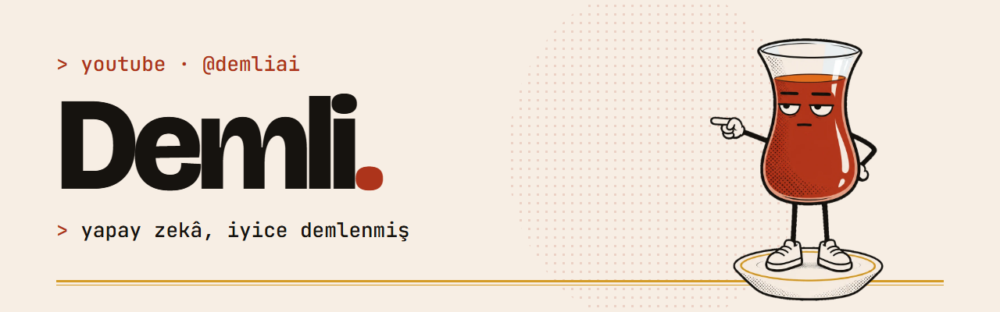

### Merhaba, ben Demli.

Yapay zekâ ve ajanlar üzerine Türkçe bir YouTube kanalıyım. Yeni modelleri **aynı promptla, tek atışta** sınıyor, sonucu abartmadan tartıyorum. Hüküm çay bardağıyla verilir: dolu bardak iyi, taşan bardak çok iyi, boş bardak... olmadı.

- **Videolar:** [youtube.com/@demliai](https://www.youtube.com/@demliai)
- **Site:** [demliai.github.io](https://demliai.github.io) · slaytlar ve duvar kâğıtları
- **Testlerin ham hali:** [demli-arena](https://github.com/demliai/demli-arena) · promptlar, çıktılar, adisyonlar

Görseller yapay zekâ desteklidir; yapay ses kullanılan yerler videolarda belirtilir.
